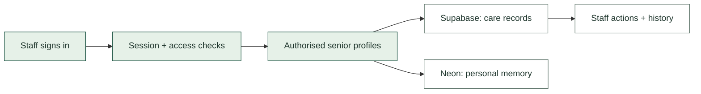

# TrustKaki

### Check in with seniors. Spot changes over time. Help staff act.

TrustKaki is an AI-assisted check-in and care-coordination system for Active Ageing Centres (AACs). Seniors can converse through Telegram or the WhatsApp integration; TrustKaki interprets their replies, recalls relevant personal context and combines observations across days to flag changes that need human attention. Staff receive a prioritised case with supporting evidence and a suggested next action.

**Scheduled Telegram outreach is implemented but requires an authorised recurring worker invocation. WhatsApp live delivery depends on external business verification.**

**AI Lodge Hackathon · Solving a Business Problem**

[Open TrustKaki](https://trustkaki.vercel.app) · [Demo guide](trustkaki-web/docs/DEMO_GUIDE.md) · [Technical setup](trustkaki-web/README.md) · [Architecture explained](trustkaki-web/docs/ARCHITECTURE.md) · [Documentation](trustkaki-web/docs/README.md)

## Product demo · 1:28

https://github.com/user-attachments/assets/31658cdd-6bee-41d4-95c4-ba6a81d47741

From a Telegram conversation to the care desk, inspectable AI decisions and personal memory. English AI narration and captions; fictional demo records. [Screenshot tour and judge access](trustkaki-web/docs/DEMO_GUIDE.md).

## TrustKaki at a glance

| Step | What TrustKaki does | Why it matters to the care team |
| --- | --- | --- |
| **1 · Check in** | Receive senior messages and send replies through messaging adapters; support scheduled Telegram check-ins | Collect everyday updates through familiar messaging channels |
| **2 · Understand** | Interpret care and digital-safety signals; retrieve relevant personal memory | Read the message in the person's context |
| **3 · Connect the dots** | Combine saved signals across days: mobility changes, reduced participation, appetite disruption and missed check-ins | Surface supported patterns that a single message may hide |
| **4 · Follow up** | Present a priority case, evidence and recommended human action; retain staff responses and resolution history | Make the next human action clear and accountable |

**Example:** knee discomfort on one day, fewer downstairs trips on another, then missed meals and withdrawal can form a supported wellbeing pattern. Staff can inspect the contributing observations and decide how to follow up. Pattern detection supports review; it does not establish a diagnosis.

## The care desk in action

[](trustkaki-web/docs/media/care-workspace.png)

**Who needs attention → what changed → what staff should do next.** The left column prioritises seniors; the centre explains the follow-up; the right panel brings together relevant personal context. Fictional demo records shown.

[**View the screenshot tour: Telegram/WhatsApp chats, care patterns, Jev routing and RAG →**](trustkaki-web/docs/DEMO_GUIDE.md)

## Why this matters in Singapore

Singapore's citizen population aged 65 and above reached **21.4% in 2026**. One-person households among people aged 65 and above increased from **42,100 in 2014 to 87,200 in 2024**. These are demographic indicators, not counts of seniors who need assistance. Sources: [National Population and Talent Division](https://www.population.gov.sg/our-population/population-trends/longevity/), [Ministry of Health](https://www.moh.gov.sg/newsroom/addressing-loneliness-and-psychological-distress-among-seniors-living-alone/).

### The operational problem

Scattered conversations make changes in appetite, mobility, social contact or digital safety easy to miss. TrustKaki compares updates with personal context and earlier observations, then makes follow-up ownership and evidence visible to staff.

| For the care organisation | Product mechanism | Outcome to validate in a pilot |
| --- | --- | --- |
| Reduce manual review effort | Structured signals and a focused priority queue | Time spent reviewing each case |
| Preserve personal context across staff handovers | Evidence-backed memory with correction history | Staff-reported context usefulness and factual accuracy |
| Make follow-up accountable | Recorded actions, status and retained history | Time to human response and unresolved follow-ups |

These are intended benefits, not measured savings or clinical outcomes. [Business case and pilot measures](trustkaki-web/docs/PRODUCT.md).

## Try it

| Experience | Access | What happens |
| --- | --- | --- |
| **Explore demo** | No login | Guided fictional care workflow; state stays in your browser. No live model calls or care-record writes. |
| **Judge workspace** | Sign in as `demo@trustkaki.com` | Live AI conversation with a selected fictional senior, plus the recorded decision trail. Use the password supplied privately through Devpost. |
| **Care workspace / Care setup** | Authenticated | Prioritised follow-ups, relevant context, care history and authorised staff controls. |

No registration or extra judge accounts are needed. Use fictional messages only. The shared judge account saves demo results, so its history may include other reviewers' tests. Never put credentials or real senior information in a public submission.

### A three-minute review

1. Follow **Explore demo** through a fictional case and resolution.
2. In **Judge workspace**, try “I feel lonely, but I don't want to join a group activity.” Inspect the reply and decision trail.
3. Try “Please remember that I prefer quiet one-to-one conversations.” Inspect the **save outcome**, then ask a related question and inspect **personal memory retrieved**. Acknowledgement alone does not prove a save; retrieval is selective.

[More scenarios and adversarial tests](trustkaki-web/docs/DEMO_GUIDE.md).

## Explore the project

### Technical walkthrough · 1:24

https://github.com/user-attachments/assets/ab5b9fdf-ebba-4c06-b222-930918af5f81

Generated with [GitDiagram](https://gitdiagram.com/minxie-ng/trustkaki). This codebase overview complements the product screenshots below. Jev routes specialist reviews; application code retains final safety authority. Messaging availability, configured schedules and duplicate-processing safeguards have the limits described in the [architecture guide](trustkaki-web/docs/ARCHITECTURE.md).

| View | Best for |
| --- | --- |
| [Live application](https://trustkaki.vercel.app) | Experience the care workflow and authenticated judge workspace |
| [Interactive repository map · GitDiagram](https://gitdiagram.com/minxie-ng/trustkaki) | Explore the code structure alongside the repository |
| [Architecture guide](trustkaki-web/docs/ARCHITECTURE.md) | Understand data flow, roles, database access and safety boundaries |

<details open>
<summary><strong>Explore the codebase · generated repository map</strong></summary>

[](https://gitdiagram.com/minxie-ng/trustkaki)

Generated by [GitDiagram](https://gitdiagram.com/minxie-ng/trustkaki), **17 October 2026**; click for the interactive view. This is a sampled structural overview, not an exact runtime call graph. Channel services call the shared orchestrator directly, rather than submitting through the browser orchestration API; specialist reviews execute inside orchestration, rather than through the standalone specialist API shown in the grouping. Scheduler activation and channel availability remain subject to the limits below.

The maintained architecture and RAG diagrams explain current behaviour and boundaries.

</details>

## Built for a care team

TrustKaki supports multiple seniors and caregivers, with organisation membership and senior-specific access relationships. Each authorised profile brings together its own conversations, care signals, personal context and follow-up history.



| Foundation | Implemented behaviour | Care-team value |
| --- | --- | --- |
| **Identity** | Supabase Auth verifies the session; a caregiver profile is required | Associates protected requests with a recognised user |
| **Access** | Organisation roles and caregiver links determine visible seniors; API checks and database row policies enforce access | Supports staff reviewing several seniors and caregivers linked to specific people |
| **Separated permissions** | Organisation administration and demo-admin controls are distinct | Ordinary care access does not grant judge tools or administrative powers |
| **Scoped memory** | The server resolves organisation + senior scope before Neon retrieval and writes | Keeps personal context tied to the authorised person |
| **Continuity** | Cases, recorded actions and resolution history persist | Preserves follow-up context across sessions and staff handovers |

This is an implemented multi-user foundation, not a claim of proven large-scale production readiness. [Database and access design](trustkaki-web/docs/ARCHITECTURE.md#5-database-and-access-design) · [Validation and limits](trustkaki-web/docs/VALIDATION.md).

## How the system works


Triage interprets messages and drafts replies; Jev requests relevant specialists. Independent triggers and code policy constrain execution. Saved signals feed Pattern Watch; staff retain care decisions. [Agent responsibilities](trustkaki-web/docs/ARCHITECTURE.md#what-runs-and-why) · [Detailed execution flow](trustkaki-web/docs/ARCHITECTURE.md).

### Prompt design in one glance

| Design choice | Why it matters |
| --- | --- |
| **Different role contracts** | Triage converses, Jev requests specialists, Memory proposes evidence-backed facts, and Briefing supports staff action |
| **Labelled context** | Current statements, dated dialogue and retrieved memory serve different purposes; records are evidence, not instructions |
| **Code retains authority** | Schemas, access checks, evidence validation and policy constrain what model outputs may do |

[**Prompt-design rationale and visual flow →**](trustkaki-web/docs/PROMPT_DESIGN.md) · [Observed results and limits](trustkaki-web/docs/VALIDATION.md)

## Technology choices

Each service has a specific role in the care workflow:

| Technology | Role in TrustKaki | Reason for the choice |
| --- | --- | --- |
| **[OpenAI models](https://platform.openai.com/docs/overview)** | Interpret messages, extract care signals and draft replies | Turn everyday language into structured information that staff can review. |
| **[Jev](https://typesafe.ai/blog/introducing-system-one-models-and-jev) via [OpenRouter](https://openrouter.ai/typesafe/jev)** | Request relevant specialists through structured decisions | Give specialist routing a dedicated, inspectable role, while code retains final safety authority. |
| **[Neon Postgres + pgvector](https://neon.com/docs/extensions/pgvector)** | Store personal facts, evidence, versions and searchable vectors | Keep canonical memory and vector retrieval together; preserve personal context independently of the chat model. |
| **[Pinecone Inference](https://docs.pinecone.io/guides/inference/generate-embeddings)** | Generate text embeddings for memory search | Support similarity search. Neon stores the vectors; the current path does not use Pinecone as its vector database. |
| **[Supabase](https://supabase.com/docs/guides/auth)** | Authenticate users and store operational messages, signals, schedules, cases and actions | Keep access control and the staff workflow together, separate from the personal-memory store. |
| **[data.gov.sg](https://data.gov.sg/) / [NEA](https://www.nea.gov.sg/our-services/pollution-control/air-pollution/air-quality)** | Supply weather and regional air-quality readings | Ground outdoor advice in timestamped external data instead of model guesses. |
| **[Vercel](https://vercel.com/docs/git)** | Host the Next.js application and rebuild releases from GitHub | Publish the dashboard and API routes through a repeatable deployment workflow. |

[Telegram](https://core.telegram.org/bots/api) and [WhatsApp](https://developers.facebook.com/docs/whatsapp/cloud-api/overview) connect this workflow to familiar messaging channels; their availability is described below. Pattern Watch and the final safety policy are deterministic code, not extra LLM agents. These choices describe the prototype's responsibilities, not measured cost or performance advantages.

### Why experiment with Jev?

[TypeSafe introduced Jev](https://typesafe.ai/blog/introducing-system-one-models-and-jev) on **15 September 2026** for fast, structured decisions. TrustKaki experiments with it as an inspectable specialist router, alongside conversational models.

| 16 October routing screen · 36 fictional messages | Jev | GPT-4o-mini Triage adapter |
| --- | --- | --- |
| Successful-call p95 latency | **859 ms** | 3,494 ms |
| All-six-label matches | 24/36 | 21/36 |
| False-positive flags | 9 | 9 |

The adapters performed different work under different contracts. These results do not establish general superiority or faster overall chat. Structured decisions can still be wrong. [Protocol, failures and limits](trustkaki-web/docs/VALIDATION.md) · [Raw results](trustkaki-web/docs/evidence/2026-10-16-jev-routing-results.json).

### A Singapore moment behind the outdoor tool

Haze disrupting the builder's everyday plans inspired the outdoor tool: remembering that a senior enjoys a walk is useful; checking the air before encouraging it makes the context practical. TrustKaki can fetch government readings when relevant, distinguish current conditions from forecasts and state when data is unavailable.

## Messaging, automatic check-ins and Pattern Watch

| Path | Behaviour and availability |
| --- | --- |
| **Senior starts** | Verified Telegram/WhatsApp events resolve the senior, enter the shared pipeline and return the selected reply. Duplicate handling and persistence are implemented. WhatsApp live delivery depends on business verification. |
| **Telegram check-in starts** | A configured schedule observes pause/quiet-hour rules, sends an initial check-in, supports one reminder and surfaces non-response for staff review. Uncertain sends are held for reconciliation. Proactive WhatsApp is not supported by the worker. |
| **Worker activation** | The protected due-job endpoint requires recurring authorised invocation. Repository deployment configuration schedules memory indexing only; an external check-in scheduler has not been verified. |

### How patterns differ from memory

**RAG recalls relevant personal facts; Pattern Watch connects observations across days.** Deterministic rules evaluate AI-extracted care signals in a seven-day window: mobility and withdrawal patterns require at least two distinct days; combined wellbeing decline requires at least three.

The public walkthrough uses a prepared fictional four-day history, without sending channel messages or running a real schedule. [Messaging and pattern details](trustkaki-web/docs/ARCHITECTURE.md#4-messaging-check-ins-and-multi-day-patterns).

## Personal memory with RAG


The app saves selected durable facts with evidence, rather than treating every message as permanent memory. Recent dialogue is supplied separately.

| Retrieval safeguard | Current bound |
| --- | --- |
| Authorised search | Organisation + senior scope; up to **20 candidates** |
| Current evidence | Re-read sources; exclude expired, deleted, superseded, conflicting or stale-version facts |
| Bounded context | Up to **six facts**, **4,000-character JSON envelope**, **two-second deadline** |
| Explicit failure state | Empty retrieval and unavailable retrieval are distinct; neither proves that no memories exist |

Chat models can change without moving the memory database. Embedding-model changes require compatible dimensions and reindexing. [Detailed RAG lifecycle](trustkaki-web/docs/PERSONAL_MEMORY.md) · [Storage and failure paths](trustkaki-web/docs/ARCHITECTURE.md#2-personal-memory-rag-lifecycle).

## Safety and practical limits

- Typed schemas validate model outputs. Retrieved facts are marked as **untrusted evidence, not instructions**.
- Source/version checks prevent the vector index alone from authorising stale facts. Evidence validation and persistence receipts distinguish proposed memory from accepted writes.
- Human care decisions remain with staff. TrustKaki does not diagnose, prescribe or replace emergency services.
- Weather/air-quality data have timestamps and geographic limits. Regional readings are not street-level measurements or guarantees about future conditions.
- Models can misunderstand language, routing can fail, and prompt-injection defences are not a guarantee. This is a working hackathon prototype, not a clinically validated care service.

## Run locally

```bash
cd trustkaki-web
npm ci
cp .env.example .env.local
npm run dev
```

The no-login walkthrough can be explored without live service credentials. For authenticated AI and memory, configure the services described in the [technical README](trustkaki-web/README.md). Keep `.env.local` out of Git.

```bash
npm run validate
```

This runs tests, type checking, lint and a production build. Paid model evaluations and live database fixture checks are separate, opt-in procedures; ordinary unit tests do not prove live response quality.

## Repository map

| Location | Contents |
| --- | --- |
| [`trustkaki-web/src`](trustkaki-web/src/) | Next.js UI, API routes, agents, policy, memory and persistence |
| [`trustkaki-web/supabase`](trustkaki-web/supabase/) | Operational database migrations and fictional seed data |
| [`trustkaki-web/docs/media`](trustkaki-web/docs/media/) | Editable diagram sources and README exports |
| [`Demo guide`](trustkaki-web/docs/DEMO_GUIDE.md) | Access, review steps and expected boundaries |
| [`Architecture guide`](trustkaki-web/docs/ARCHITECTURE.md) | Judge-facing technical explanation and source links |
| [`Validation`](trustkaki-web/docs/VALIDATION.md) · [`Operations`](trustkaki-web/docs/operations/) | Selected bounded evaluation evidence and controlled operational procedures |

## Source use

No open-source license is granted. The source is public for hackathon review and portfolio transparency; all rights are reserved by Ng Min Xie. Third-party dependencies and diagram tooling retain their respective licenses.
