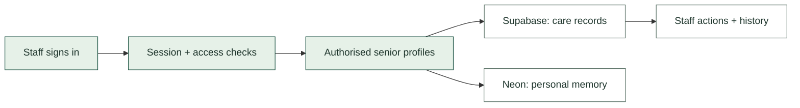
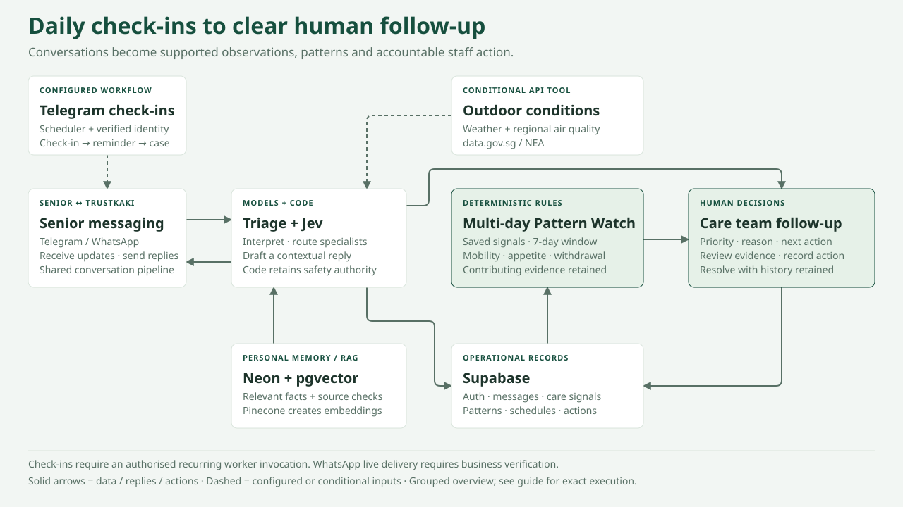
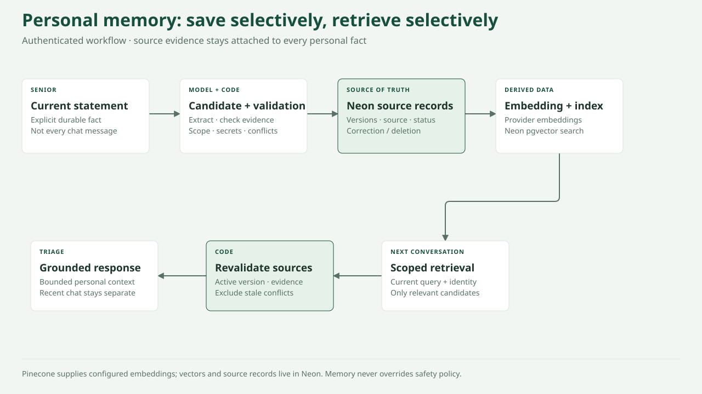

# TrustKaki

### Check in with seniors. Spot changes over time. Help staff act.

TrustKaki is an AI-assisted check-in and care-coordination system for Active Ageing Centres (AACs). Seniors can converse through Telegram or the WhatsApp integration; TrustKaki interprets their replies, recalls relevant personal context and combines observations across days to flag changes that need human attention. Staff receive a prioritised case with supporting evidence and a suggested next action.

The implemented Telegram check-in workflow can initiate a scheduled message, send one reminder and surface non-response for staff follow-up when an authorised scheduler runs it. Channel availability and deployment requirements are detailed below.

**AI Lodge Hackathon · Solving a Business Problem**

[Open TrustKaki](https://trustkaki.vercel.app) · [Judge guide](trustkaki-web/docs/JUDGE_GUIDE.md) · [Technical setup](trustkaki-web/README.md) · [Architecture explained](trustkaki-web/docs/ARCHITECTURE_GUIDE.md) · [Documentation](trustkaki-web/docs/README.md)

## TrustKaki at a glance

| Step | What TrustKaki does | Why it matters to the care team |
| --- | --- | --- |
| **1 · Check in** | Receive senior messages and send replies through messaging adapters; support scheduled Telegram check-ins | Collect everyday updates through familiar messaging channels |
| **2 · Understand** | Interpret care and digital-safety signals; retrieve relevant personal memory | Read the message in the person's context |
| **3 · Connect the dots** | Combine saved signals across days: mobility changes, reduced participation, appetite disruption and missed check-ins | Surface supported patterns that a single message may hide |
| **4 · Follow up** | Present a priority case, evidence and recommended human action; retain staff responses and resolution history | Make the next human action clear and accountable |

**Example:** knee discomfort on one day, fewer downstairs trips on another, then missed meals and withdrawal can form a supported wellbeing pattern. Staff can inspect the contributing observations and decide how to follow up. Pattern detection supports review; it does not establish a diagnosis.

## Why this matters in Singapore

Singapore's citizen population aged 65 and above reached **21.4% in 2026**. One-person households among people aged 65 and above increased from **42,100 in 2014 to 87,200 in 2024**. These are demographic indicators, not counts of seniors who need assistance. Sources: [National Population and Talent Division](https://www.population.gov.sg/our-population/population-trends/longevity/), [Ministry of Health](https://www.moh.gov.sg/newsroom/addressing-loneliness-and-psychological-distress-among-seniors-living-alone/).

Care demand is growing alongside workforce expansion: MOH projects the healthcare workforce to grow from **129,000 in 2024 to about 156,000 in 2030**, while describing current staffing as broadly adequate. TrustKaki targets the coordination burden on care teams; it does not assume that AI can replace caregivers. [MOH workforce outlook](https://www.moh.gov.sg/newsroom/current-healthcare-workforce-strength-compared-against-projected-service-demand/).

### The operational problem

AAC staff support many seniors across everyday conversations. A change in appetite, mobility, social contact or digital safety can be easy to miss when messages are scattered and follow-up responsibility is unclear. A message also means more when compared with that person's routine and earlier context.

**TrustKaki turns conversations into a shared, prioritised care workflow:** who needs attention, what changed, and the next human action. Staff can record an outcome, resolve a follow-up and retain its history.

| For the care organisation | Product mechanism | Outcome to validate in a pilot |
| --- | --- | --- |
| Reduce manual review effort | Structured signals and a focused priority queue | Time spent reviewing each case |
| Preserve personal context across staff handovers | Evidence-backed memory with correction history | Staff-reported context usefulness and factual accuracy |
| Make follow-up accountable | Recorded actions, status and retained history | Time to human response and unresolved follow-ups |

These are intended benefits, not measured savings or clinical outcomes. [Business case and pilot measures](trustkaki-web/docs/BUSINESS_CASE.md).

## Try it

| Experience | Access | What happens |
| --- | --- | --- |
| **Explore demo** | No login | Guided fictional care workflow; state stays in your browser. No live model calls or care-record writes. |
| **Judge workspace** | Sign in as `demo@trustkaki.com` | Live AI conversation with a selected fictional senior, plus the recorded decision trail. Use the password supplied privately through Devpost. |
| **Care workspace / Care setup** | Authenticated | Prioritised follow-ups, relevant context, care history and authorised staff controls. |

No registration or extra judge accounts are needed. Use fictional messages only. The shared judge account saves demo results, so its history may include other reviewers' tests. Never put credentials or real senior information in a public submission.

### A three-minute review

1. Open **Explore demo** and follow the guided steps to see a care case through to resolution.
2. Sign in, choose **Judge workspace**, and select a fictional senior.
3. Send a message such as “I feel lonely, but I don't want to join a group activity.” Read the reply and expand its decision trail.
4. Try “Please remember that I prefer quiet one-to-one conversations.” Inspect the **save outcome**; a generated acknowledgement alone does not prove persistence.
5. Ask a related question later and inspect **personal memory retrieved**. Retrieval is selective; every stored fact will not appear on every turn.

See the [judge guide](trustkaki-web/docs/JUDGE_GUIDE.md) for outdoor-advice examples and responsible adversarial tests.

## Built for a care team

TrustKaki supports multiple seniors and caregivers, with organisation membership and senior-specific access relationships. Each authorised profile brings together its own conversations, care signals, personal context and follow-up history.



| Foundation | Implemented behaviour | Care-team value |
| --- | --- | --- |
| **Identity** | Supabase Auth verifies the session; a caregiver profile is required | Associates protected requests with a recognised user |
| **Access** | Organisation roles and caregiver links determine visible seniors; API checks and database row policies enforce access | Supports staff reviewing several seniors and caregivers linked to specific people |
| **Separated permissions** | Organisation administration and demo-admin controls are distinct | Ordinary care access does not grant judge tools or administrative powers |
| **Scoped memory** | The server resolves organisation + senior scope before Neon retrieval and writes | Keeps personal context tied to the authorised person |
| **Continuity** | Cases, recorded actions and resolution history persist | Preserves follow-up context across sessions and staff handovers |

This is an implemented multi-user foundation, not a claim of proven large-scale production readiness. [Database and access design](trustkaki-web/docs/ARCHITECTURE_GUIDE.md#5-database-and-access-design) · [Validation and limits](trustkaki-web/docs/VALIDATION.md).

## How the system works



| Component | Responsibility |
| --- | --- |
| Triage | Interpret the message, extract structured care signals and draft a conversational reply. |
| Jev via OpenRouter | Request relevant specialists through structured routing decisions. Independent safety/context triggers and code exclusions still apply. |
| Conditional specialists | Review digital safety, personal context and community engagement where relevant; prepare caregiver briefings. |
| Outdoor conditions tool | Fetch weather and regional air-quality information from data.gov.sg/NEA when outdoor context calls for it. It is a tool, not another LLM agent. |
| Pattern Watch | Combine saved care signals across multiple days and surface evidence-backed follow-up cases. |
| Check-in worker | Process configured Telegram check-ins, a reminder and response deadlines when invoked by an authorised scheduler. |
| Deterministic policy | Validate outputs and enforce final safety rules. A model cannot override policy. |
| Care team | Review priority, reason and recommended action; record the actual human response. |

The selected reply returns to the conversation. Operational results and follow-up history support the staff dashboard. The diagram groups conditional roles for readability; the [architecture guide](trustkaki-web/docs/ARCHITECTURE_GUIDE.md) expands their responsibilities and boundaries.

## Technology choices

Each service has a specific role in the care workflow:

| Technology | Role in TrustKaki | Reason for the choice |
| --- | --- | --- |
| **[OpenAI models](https://platform.openai.com/docs/overview)** | Interpret messages, extract care signals and draft replies | Turn everyday language into structured information that staff can review. |
| **[Jev](https://typesafe.ai/blog/introducing-system-one-models-and-jev) via [OpenRouter](https://openrouter.ai/typesafe/jev)** | Request relevant specialists through structured decisions | Give specialist routing a dedicated, inspectable role, while code retains final safety authority. |
| **[Neon Postgres + pgvector](https://neon.com/docs/extensions/pgvector)** | Store personal facts, evidence, versions and searchable vectors | Keep canonical memory and vector retrieval together; preserve personal context independently of the chat model. |
| **[Pinecone Inference](https://docs.pinecone.io/guides/inference/generate-embeddings)** | Generate text embeddings for memory search | Support similarity search. Neon stores the vectors; the current path does not use Pinecone as its vector database. |
| **[Supabase](https://supabase.com/docs/guides/auth)** | Authenticate users and store operational messages, signals, schedules, cases and actions | Keep access control and the staff workflow together, separate from the personal-memory store. |
| **[data.gov.sg](https://data.gov.sg/) / [NEA](https://www.nea.gov.sg/our-services/pollution-control/air-pollution/air-quality)** | Supply weather and regional air-quality readings | Ground outdoor advice in timestamped external data instead of model guesses. |
| **[Vercel](https://vercel.com/docs/git)** | Host the Next.js application and rebuild releases from GitHub | Publish the dashboard and API routes through a repeatable deployment workflow. |

[Telegram](https://core.telegram.org/bots/api) and [WhatsApp](https://developers.facebook.com/docs/whatsapp/cloud-api/overview) connect this workflow to familiar messaging channels; their availability is described below. Pattern Watch and the final safety policy are deterministic code, not extra LLM agents. These choices describe the prototype's responsibilities, not measured cost or performance advantages.

### Why experiment with Jev?

TypeSafe introduced Jev on **15 September 2026** as a System One model designed for fast, structured decisions. TrustKaki uses that approach for specialist routing: the model selects bounded decisions that software can inspect, while conversational models handle interpretation and reply generation. [TypeSafe's introduction](https://typesafe.ai/blog/introducing-system-one-models-and-jev).

In the **16 October routing screen**, 36 fictional messages produced a **p95 successful-call latency of 859 ms for Jev versus 3,494 ms for the GPT-4o-mini Triage adapter**. All-six-label matches were **24/36 versus 21/36**, with nine false-positive flags each. The adapters performed different work and used different contracts; these observations support exploring a dedicated decision model, not a claim that Jev is generally better or that adding it makes the whole conversation faster. Failed attempts and broader response-quality limits are retained in the [validation record](trustkaki-web/docs/VALIDATION.md) and [raw routing report](trustkaki-web/docs/evidence/2026-10-16-jev-routing-results.json). Structured output still requires validation and can be semantically wrong; code and staff retain safety authority.

### A Singapore moment behind the outdoor tool

The outdoor-advice feature grew out of the builder's experience of haze disrupting everyday plans in Singapore. Remembering that a senior enjoys a walk is useful; checking the air before encouraging that walk makes the context more practical.

When a conversation calls for outdoor advice, TrustKaki can fetch government weather and regional air-quality data. It distinguishes current readings from future forecasts and states when information is unavailable. It is a contextual advisory tool, not continuous monitoring or a guarantee that an outing is safe.

## Messaging, automatic check-ins and Pattern Watch

### Two ways a conversation starts

- **Senior starts:** an authenticated channel webhook maps an incoming Telegram/WhatsApp message to the senior. The shared AI pipeline interprets it, records results and sends the selected reply through that channel.
- **Configured check-in starts:** the Telegram worker processes a staff-configured schedule, observes pause/quiet-hour rules, sends a check-in and waits for a response. It supports one reminder, then a staff follow-up case after the final response deadline. Delivery uncertainty is held for reconciliation rather than blindly resending.

| Capability | Current implementation / availability |
| --- | --- |
| Telegram conversation | Inbound webhook, identity mapping, automatic replies, persistence and duplicate-update protection are implemented. A bounded earlier live path was recorded; this documentation update does not retest delivery. |
| WhatsApp conversation | Inbound webhook/signature checks, automatic reply and delivery-status handling are implemented. Final live delivery remains dependent on external business verification. |
| Scheduled outbound check-ins | Implemented for **Telegram**. The schedule contract also accepts WhatsApp, but the current outbound check-in worker rejects that transport. |
| Scheduler activation | A protected due-job endpoint exists. Repository deployment configuration schedules only memory indexing; automatic check-in dispatch requires a separately configured, authorised recurring invocation. No external scheduler was verified in this review. |
| Multi-day patterns | Persistent Pattern Watch evaluates saved signals and consolidates supporting patterns into a staff follow-up case. |

### How patterns differ from memory

**RAG retrieves relevant facts about the person. Pattern Watch connects observations over time.** AI extracts structured signals; deterministic Pattern Watch rules evaluate supported combinations within a seven-day signal window. Mobility and social-withdrawal patterns need observations on at least two distinct days; a combined wellbeing-decline pattern needs at least three. Existing routine/context records help explain the case to staff.

The public guided demo includes a prepared fictional four-day history. It demonstrates the care workflow; it does not send Telegram/WhatsApp messages or wait through a real schedule. [Messaging and pattern implementation](trustkaki-web/docs/ARCHITECTURE_GUIDE.md#4-messaging-check-ins-and-multi-day-patterns).

## Personal memory with RAG



**RAG is the retrieval method; Neon is the personal-memory database.** The app saves selected durable facts with evidence rather than treating every message as permanent personal memory.

- **Neon Postgres + pgvector:** personal facts, versions, evidence references, lifecycle and vector search in one database.
- **Pinecone inference:** creates embeddings using `llama-text-embed-v2` (1,024 dimensions). The current path does not use the historical Pinecone vector index.
- **Supabase:** authentication, access relationships, conversation messages and operational care records. Essential care/accessibility and verified contact routing remain operational data.
- **Recent conversation:** supplied separately from long-term retrieval, so ordinary follow-up messages can refer to the current conversation.

Retrieval searches only the authorised organisation/senior scope, considers up to **20 candidates**, then re-reads current sources. It excludes expired, deleted, superseded, conflicting or stale-version facts. At most **six facts** enter a **4,000-character JSON envelope**, with a **two-second retrieval deadline**. Empty and unavailable results are distinct; neither proves that the person has no stored memories.

Changing the chat model does not require moving the memory database. Changing the embedding model requires compatible dimensions and reindexing; vectors from different models are not interchangeable.

[Detailed RAG implementation](trustkaki-web/docs/PERSONAL_MEMORY_RAG_GUIDE.md) · [Presentation notes and failure paths](trustkaki-web/docs/ARCHITECTURE_GUIDE.md)

## Safety and practical limits

- Typed schemas validate model outputs. Retrieved facts are marked as **untrusted evidence, not instructions**.
- Source/version checks prevent the vector index alone from authorising stale facts. Evidence validation and persistence receipts distinguish proposed memory from accepted writes.
- Human care decisions remain with staff. TrustKaki does not diagnose, prescribe or replace emergency services.
- Weather/air-quality data have timestamps and geographic limits. Regional readings are not street-level measurements or guarantees about future conditions.
- Models can misunderstand language, routing can fail, and prompt-injection defences are not a guarantee. This is a working hackathon prototype, not a clinically validated care service.
- Messaging adapters exist; final WhatsApp delivery remains dependent on external business verification. The authenticated browser demo is the recommended judging path.

## Run locally

```bash
cd trustkaki-web
npm ci
cp .env.example .env.local
npm run dev
```

The no-login walkthrough can be explored without live service credentials. For authenticated AI and memory, configure the services described in the [technical README](trustkaki-web/README.md). Keep `.env.local` out of Git.

```bash
npm run validate
```

This runs tests, type checking, lint and a production build. Paid model evaluations and live database fixture checks are separate, opt-in procedures; ordinary unit tests do not prove live response quality.

## Repository map

| Location | Contents |
| --- | --- |
| [`trustkaki-web/src`](trustkaki-web/src/) | Next.js UI, API routes, agents, policy, memory and persistence |
| [`trustkaki-web/supabase`](trustkaki-web/supabase/) | Operational database migrations and fictional seed data |
| [`trustkaki-web/docs/media`](trustkaki-web/docs/media/) | Editable diagram sources and README exports |
| [`Judge guide`](trustkaki-web/docs/JUDGE_GUIDE.md) | Access, review steps and expected boundaries |
| [`Architecture guide`](trustkaki-web/docs/ARCHITECTURE_GUIDE.md) | Judge-facing technical explanation and source links |
| [`Validation`](trustkaki-web/docs/VALIDATION.md) · [`Operations`](trustkaki-web/docs/operations/) | Selected bounded evaluation evidence and controlled operational procedures |

## Source use

No open-source license is granted. The source is public for hackathon review and portfolio transparency; all rights are reserved by Ng Min Xie. Third-party dependencies and diagram tooling retain their respective licenses.
