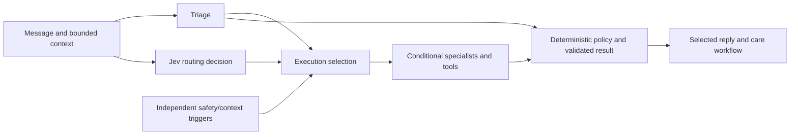

# Agent and tool design

[Documentation](README.md) · [Architecture](ARCHITECTURE_GUIDE.md) · [RAG](PERSONAL_MEMORY_RAG_GUIDE.md)

TrustKaki uses models for language interpretation and bounded specialist decisions. Application code controls identity, validation, persistence and final safety policy. Each role has a defined output contract; adding more agents is not itself a product benefit.

## Responsibilities

| Role | Why it exists | Boundary |
| --- | --- | --- |
| Triage | Convert varied natural language into structured care signals and a draft reply | Does not decide final policy or prove a memory was saved |
| Jev specialist router | Select relevant specialist reviews from bounded context | Requests remain subject to exclusions and independent triggers |
| Context Memory | Extract durable personal facts with evidence from the current message | Validation and the repository decide whether a write is accepted |
| Digital Safety | Review suspicious messages and payment/account-access concerns | Cannot perform transactions or take over an account |
| AAC Nudge and social intent | Support respectful community engagement, including refusal | Cannot invent event availability or enrol/contact anyone |
| Briefing | Present relevant information for caregiver review | Staff decide and record the human action |
| Outdoor conditions tool | Retrieve government weather and air-quality data | An API tool, not an additional LLM agent; freshness and geography limit advice |
| Pattern Watch | Combine persisted care signals across days and retain supporting evidence | Deterministic rules over model-extracted signals; not clinical prediction |
| Telegram check-in worker | Process configured check-ins, one reminder and response deadlines | Requires a recurring authorised invocation; not another LLM agent |
| Policy layer | Apply final deterministic safety rules | Model output and retrieved memory cannot override it |

## Routing versus authority

Requested and executed specialists can differ. This distinction is recorded in the judge decision trail. Jev is a meaningful routing component, but it is not an unrestricted final authority over care risk, contact routing or memory persistence.

## Prompt and contract design

The [system prompts](../src/lib/agents/prompts.ts) define role scope, input trust, tone and required structured outputs. The [schemas](../src/lib/agents/schemas.ts), [runner](../src/lib/agents/runner.ts) and [policy](../src/lib/agents/policy.ts) enforce application contracts around those prompts.

- Current senior statements, historical conversation and retrieved memory are labelled separately.
- Personal-memory evidence is not an instruction channel.
- Conversation wording should respect the senior's choice, avoid repetitive generic questions and use relevant recent dialogue.
- A proposed fact and an accepted write are separate events; success claims require the persistence outcome.
- Public-data advice must remain bounded by available source information and departure context.

Prompts influence probabilistic behaviour; they do not guarantee faithful conversation. Schema validation catches structural errors, while semantic mistakes require targeted evaluation and real-user review.

## Inspectability and limitations

The authenticated judge workspace exposes retrieved memory, agent/model results, routing decisions, actual execution, final policy and save outcomes. Ordinary staff receive the focused care workflow rather than needing technical traces.

The [validation summary](VALIDATION.md) and selected [machine-readable reports](evidence/) document bounded comparisons, errors and partial results. These are not clinical validation, exhaustive language coverage or proof of prompt-injection immunity. Laya was considered during exploration; the current documented integration uses Jev through OpenRouter.
