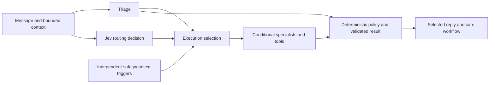
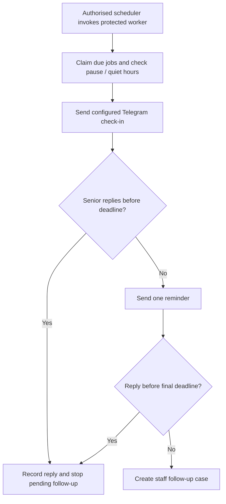
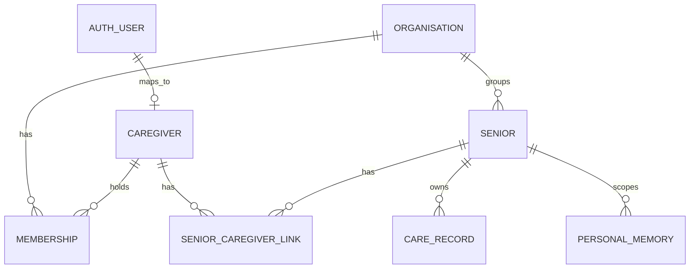

# TrustKaki system architecture

[Overview](../../README.md) · [Demo guide](DEMO_GUIDE.md) · [Prompt design](PROMPT_DESIGN.md) · [Personal memory](PERSONAL_MEMORY.md)

TrustKaki combines messaging, configured Telegram check-ins, language models, multi-day pattern rules, scoped personal memory and a staff workflow. The overview shows how conversations become observations and human follow-up; the memory diagram expands the evidence and retrieval lifecycle. Editable HTML and standalone SVG versions are available in [media](media/).

## 1. Message to human follow-up

TrustKaki turns an everyday message into a traceable care workflow. Triage interprets the message, Jev requests relevant specialists, and code enforces the final safety policy. Staff see who needs attention, why, and the recommended human action.

### What runs and why

| Stage | Inputs and job | Authority/boundary |
| --- | --- | --- |
| Identity and access | Verified staff session or verified channel mapping resolves the senior and organisation. | Client-supplied identifiers alone do not grant access. |
| Context assembly | Recent messages, essential operational context and selectively retrieved personal facts. | Recent dialogue and durable memory are separate inputs. |
| Triage | Structured care signals, urgency interpretation, outdoor context and a draft reply. | Output must pass typed validation; a model suggestion is not final policy. |
| Jev routing | Structured decisions about which specialist reviews are relevant. | Active routing coexists with independent triggers and deterministic exclusions. Requested and executed routes can differ. |
| Context Memory | Proposes durable facts from current senior-authored evidence. | Server validation, source evidence and a persistence result determine acceptance. |
| Digital Safety | Reviews suspicious digital/payment situations when relevant. | Cannot authorise payments, gain account access or override policy. |
| AAC Nudge / social decision | Supports low-pressure community engagement and respects refusal. | Does not autonomously enrol a senior or contact an organiser. |
| Outdoor tool | Retrieves public forecast and air-quality facts when outdoor context is relevant. | Data freshness, destination and timing constrain advice; it is ordinary API integration, not another model. |
| Briefing | Organises relevant results for caregiver review. | Proposed human action remains a recommendation. |
| Policy and persistence | Applies final rules; records operational results and accepted memory writes. | Care records go to Supabase; personal memory goes to Neon. |
| Human workflow | Prioritise, follow up, record an outcome, resolve and retain history. | Staff remain accountable for actual care decisions. |

The overview groups Triage, Jev, conditional specialist reviews and code policy in one interpretation/control node. Saved operational signals feed Pattern Watch; a direct route also reaches staff for concerns that do not require a multi-day pattern. The return arrow represents the selected channel reply, while staff actions return to operational history. The diagram shows information dependencies rather than every request or exact scheduling. Authentication precedes access to both stores.

Source: [`orchestrator.ts`](../src/lib/agents/orchestrator.ts), [`prompts.ts`](../src/lib/agents/prompts.ts), [`policy.ts`](../src/lib/agents/policy.ts), [`specialistRouting.ts`](../src/lib/agents/specialistRouting.ts).

### Routing and final authority

Requested and executed specialists can differ. This distinction is recorded in the judge decision trail. Jev is a meaningful routing component, but it is not an unrestricted final authority over care risk, contact routing or memory persistence.

The [prompt-design guide](PROMPT_DESIGN.md) explains the role contracts, context hierarchy and safeguards behind these stages. Outdoor data, Pattern Watch, scheduled check-ins and policy are code/tools rather than extra LLM agents.

## 2. Personal-memory RAG lifecycle

Neon holds personal facts and their evidence. Embeddings identify relevant candidates, but similarity is only a search signal. The application re-reads the current source record before supplying a fact to the model.

### Write path

1. A current, verified senior message supplies evidence. The extraction model proposes an explicit durable fact; not every utterance becomes long-term memory.
2. Server validation checks evidence, scope, purpose, confidence and expiry. Essential care/accessibility and verified contact-routing data remain operational records.
3. A scoped Neon transaction stores an accepted personal fact with source attribution, version, revision and command receipt. A source write and successful indexing are distinct outcomes.
4. The embedding provider converts approved fact text into a vector. Publication checks the source version and embedding model again; an outdated indexing job cannot publish against a newer fact.
5. Failed indexing leaves an accepted source pending. Bounded leases/retries and a protected worker support recovery; a pending fact is not immediately searchable simply because its source was saved.

### Read path and exact bounds

| Check | Current behaviour |
| --- | --- |
| Query | Non-empty; at most 2,000 Unicode code points |
| Identity | Resolve authorised organisation and senior before search |
| Embedding | Configured model must match the index model |
| Candidate search | Cosine similarity in the scoped store; at most 20 hits and a configured minimum score |
| Source verification | Re-read records; require matching identity/version, active status, usable provenance, confirmation date and unexpired lifetime |
| Conflicts | Exclude unresolved conflict groups rather than silently choosing a competing claim |
| Context size | At most six facts; content and evidence excerpts each at most 280 code points; total JSON envelope at most 4,000 code points |
| Deadline | Two seconds for the retrieval operation; unavailable is distinguished from an empty result |
| Trust | Envelope identifies facts as `untrusted_evidence_not_instructions` |

Source: [`retrieval.ts`](../src/lib/memory/retrieval.ts), [`postgresStore.ts`](../src/lib/memory/postgresStore.ts), [`indexWorker.ts`](../src/lib/memory/indexWorker.ts). The [implementation guide](PERSONAL_MEMORY.md) explains transaction, recovery and migration details.

### Tool and storage responsibilities

| Technology | What it owns | Why it is here |
| --- | --- | --- |
| Neon Postgres | Personal facts, evidence references, lifecycle, versions, receipts and vectors | Keeps canonical memory and its search index within one transactional database boundary. |
| pgvector | Similarity operations over Neon vectors | Retrieves semantically relevant candidate facts without loading all memory into a prompt. |
| Pinecone inference | `llama-text-embed-v2`, 1,024-dimensional embeddings | Converts text to vectors. The historical Pinecone vector database is not queried by the current Neon path. |
| Supabase | Authentication, access relationships, messages, operational care records and essential routing context | Continues supporting the existing staff workflow and operational history. |
| Chat provider | Interpretation and language generation | Can change independently of canonical memory storage, subject to contract and evaluation compatibility. |

### Honest benefits and trade-offs

- **Bounded prompt growth:** only a small selection enters each request. RAG does not eliminate stored data growth; messages, audit history and source facts still need retention policies.
- **Personalisation with provenance:** a preference can be tied to its evidence and corrected or retired. Semantic relevance alone is not proof that a claim is true.
- **Portability:** chat models can share the same memory repository. Replacing an embedding model requires reindexing and threshold calibration; replacing a database still requires migration.
- **Failure isolation:** empty/unavailable retrieval lets the application avoid inventing recalled facts. It does not guarantee a good conversational answer; recent dialogue and response composition must also work correctly.
- **Practical scale:** scoped vector retrieval avoids passing a whole personal history into the model. This is an architectural benefit, not a claim of measured million-user capacity.

## 3. Inspectability and evaluation

The authenticated judge workspace distinguishes requested from executed specialists, retrieved from stored facts, and proposed from accepted memory writes. Its decision trail exposes actual recorded outcomes. The [review guide](DEMO_GUIDE.md) describes access and example scenarios.

Dated tests and evaluation reports are evidence for their documented cases and builds. A unit-test count does not measure clinical safety, live response quality or prompt-injection immunity.

## 4. Messaging, check-ins and multi-day patterns

### Reactive messaging

Telegram and WhatsApp adapters parse verified inbound events, resolve a mapped senior, call the shared conversation pipeline, persist results and send the selected reply through the originating channel. Event handling includes duplicate protection and bounded processing/recovery. WhatsApp additionally verifies webhook signatures and records delivery status. Provider acceptance is distinct from confirmed delivery.

Sources: [Telegram service](../src/lib/telegram/service.ts), [WhatsApp service](../src/lib/whatsapp/service.ts).

### Optional Telegram voice input

Voice input is disabled by default. After applying the voice-draft migration, configure server-only `GROQ_API_KEY` and explicitly enable `TRUSTKAKI_TELEGRAM_VOICE_ENABLED=true`. The adapter uses Groq `whisper-large-v3`; verify the account remains on the intended free tier and review its Data Controls before activation. Audio is transmitted to Groq for transcription; TrustKaki does not persist audio. Provider retention is separate from application retention.

Only verified private-chat identities can download/transcribe notes. Limits are 60 seconds, 2 MB, five drafts per minute per identity, 20 per rolling day per identity and 100 globally per rolling day. Each draft permits one transcription attempt; an interrupted attempt asks the user to resend or type rather than silently repeat inference. Downloads and transcription have 15- and 20-second deadlines respectively.

The senior receives “I heard…” with Confirm / Try again. Unconfirmed transcripts are not care evidence, agent input or personal memory. Confirmation rechecks identity and creates one durable text event with voice provenance; ordinary text retains its existing path. Drafts become unusable after 10 minutes. Transcript text is erased on confirmation/discard/supersession and by opportunistic expiry cleanup; the authenticated daily `/api/internal/telegram/voice-cleanup` job removes expired text even if voice is disabled. Physical expiry cleanup can therefore lag expiry until the next successful job. Minimal admission/receipt metadata is retained. Confirmed text follows existing care-record retention.

Use fictional audio for acceptance testing. Check speech, silence, language mixing, correction, expiry, duplicate confirmation and unavailable-provider behaviour. Transcription accuracy for Singlish and mixed languages is not guaranteed. This confirmation-first channel is not an emergency service. A lost provider acknowledgement can duplicate a control prompt; it does not create a second confirmed text event. Existing Telegram processing/reset concurrency limits still apply.

### Proactive Telegram check-ins

This is the logical state progression; each stage requires a worker invocation when due. The worker uses approved context tags to adjust configured wording, records send intent/provider acceptance, and holds uncertain sends for reconciliation. It is bounded workflow code, not an agent deciding to repeatedly contact someone.

**Deployment boundary:** [vercel.json](../vercel.json) declares the memory-indexing cron and a daily voice-draft cleanup cron. Scheduled senior check-ins require a separately authorised recurring caller to `/api/internal/check-ins/process-due`, configured senior schedules, verified Telegram identities and provider credentials. The current worker supports Telegram only, despite a broader schedule schema. This guide does not claim an externally configured scheduler or current live channel health.

Sources: [check-in processor](../src/lib/checkins/service.ts), [timing policy](../src/lib/checkins/policy.ts), [protected endpoint](../src/app/api/internal/check-ins/process-due/route.ts), [schedule repository](../src/lib/persistence/proactiveCheckInRepository.ts).

### Persistent Pattern Watch

After an orchestration result is saved, the repository re-evaluates that senior's saved signals and operational routine/context records. Pattern candidates retain their contributing signal IDs. Related open patterns are consolidated into a staff case, with the reason, change from usual, recommended action and evidence timeline.

| Rule | Required evidence within the seven-day signal window |
| --- | --- |
| Mobility and frailty | Mobility discomfort plus reduced movement; at least two observations on two distinct dates |
| Social withdrawal | Reduced participation plus missed/delayed check-in signals; at least two observations on two distinct dates |
| Combined wellbeing decline | Appetite disruption plus mobility/reduced-movement and withdrawal/non-response signals; at least three observations on three distinct dates |

The window is anchored to the latest supplied signal. The rules inspect structured signal types and terms in their descriptions; they are not a learned forecasting model or proof of clinical deterioration. AI interpretation errors can propagate into pattern inputs. Routine context helps explain the comparison; RAG retrieval and pattern evaluation remain distinct mechanisms. Closing a staff case does not itself change the senior's assessed risk.

Sources: [Pattern Watch rules](../src/lib/patterns/patternWatch.ts), [persistent pattern updates](../src/lib/persistence/patternRepository.ts), [queue consolidation](../src/lib/patterns/queueConsolidation.ts).

## 5. Database and access design

Authentication establishes identity; authorisation determines which senior and operation that identity may access. The browser's selected senior is a request parameter, not an access grant.

### Identity and relationship model

This is a conceptual relationship view, not a complete schema. Supabase holds identity/access relationships and operational care records; Neon holds personal-memory records. The relationship across stores is resolved by application code, not a cross-database foreign key.

| Access path | Current rule |
| --- | --- |
| Staff / organisation administrator | Active organisation and membership allow access to seniors in that organisation |
| Family caregiver | A caregiver link permits access to its specific senior |
| Volunteer | Active volunteer membership plus a matching senior assignment is required |
| Organisation administration | Requires the appropriate organisation-admin membership; ordinary read access is insufficient |
| Demo administration | Uses trusted application metadata and separate endpoint checks; it does not substitute for senior access or organisation administration |

### Enforcement and storage boundaries

1. The server verifies the bearer token with Supabase Auth and requires a matching caregiver profile. Missing identity/profile or failed access lookups deny the request.
2. A user-scoped Supabase client obtains row-policy-filtered seniors and active memberships. The server derives accessible and administrable senior IDs and checks the requested operation.
3. For personal memory, the application resolves organisation + senior from the stored senior record. It does not accept a caller-supplied organisation as authority.
4. Neon transactions set the restricted memory runtime role and organisation/senior scope. Scoped SQL and database row policies constrain memory records and vectors; current-source checks additionally govern what reaches the model.
5. Operational cases and staff actions remain persistent records. Resolving a follow-up retains its history and does not itself rewrite the senior's assessed risk.

The no-login Explore demo uses browser-local fictional state. Authenticated judge tools are a separate experience; their shared fictional account is not an example of individual staff-account management.

Sources: [session and access checks](../src/lib/auth/session.ts), [organisation and senior access policies](../supabase/migrations/20260717173000_gate_6_organisation_tenancy_foundation.sql), [memory scope resolution](../src/lib/memory/applicationRepository.ts), [Neon transaction role and scope](../src/lib/memory/neonDatabase.ts). [Validation](VALIDATION.md) distinguishes recorded checks from unverified production scale and real-world outcomes.

### Voice transcription language
Care setup → Context lets an organisation administrator save a senior-specific voice language: English (`en`), Malay (`ms`), Mandarin (`zh`), Tamil (`ta`), or Automatic (`null`). The authorised senior's setting is loaded before downloading/transcribing each new voice note and passed as Groq's `language` parameter. Automatic omits that parameter. Preference lookup failures ask for typed input rather than silently guessing. Existing profiles remain Automatic; the migration does not infer or populate preferences. Changing this setting affects new transcriptions, not already staged drafts or the care reply's language. Short recordings and mixed-language speech can still be transcribed incorrectly; explicit transcript confirmation remains required.
