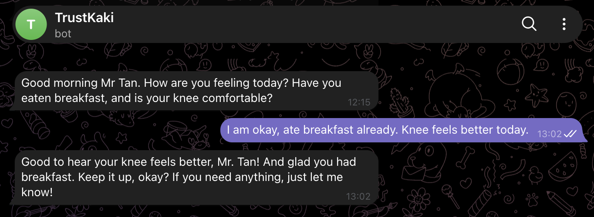
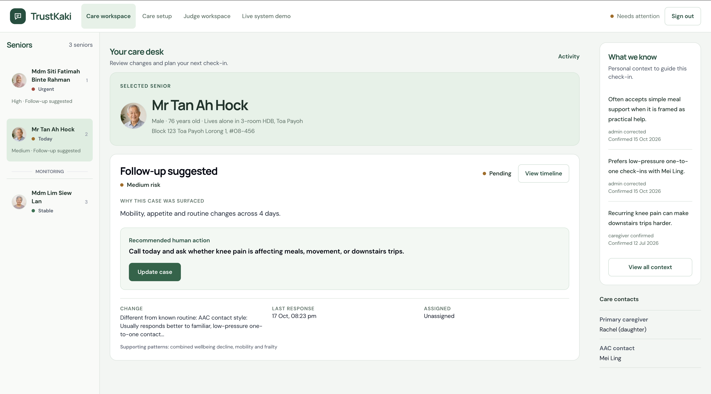
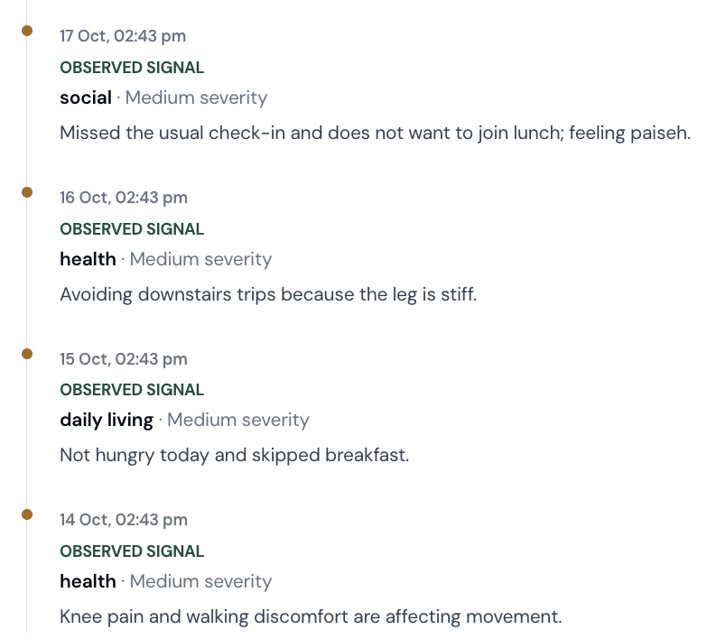
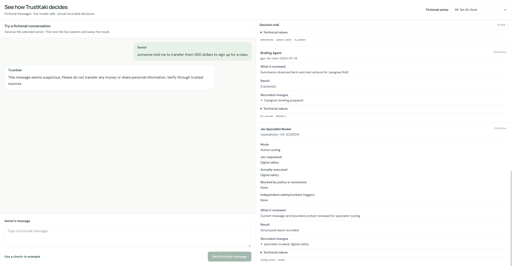
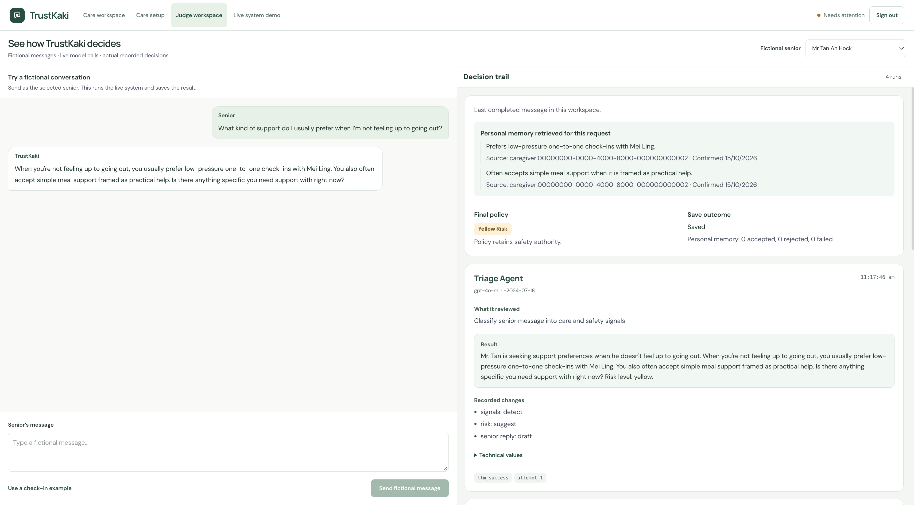

# Demo guide: TrustKaki in action

[Project overview](../../README.md) · [Try TrustKaki](https://trustkaki.vercel.app) · [Documentation](README.md)

**Everyday conversations → changes across days → informed human follow-up.** These screenshots show how an AAC team can review a senior's situation and inspect the AI behind it.

All people and care records shown are fictional. Captured **18 October 2026 (SGT)**; screenshots preserve the displayed UI and outputs. Click each image for its full-resolution view.

## Product demo · 1:28

https://github.com/user-attachments/assets/31658cdd-6bee-41d4-95c4-ba6a81d47741

Telegram conversation → care workspace → judge decision trail → a separately recorded personal-memory example. English AI narration and captions. The [technical walkthrough](https://github.com/user-attachments/assets/ab5b9fdf-ebba-4c06-b222-930918af5f81) explains the codebase separately.

## Access

Open [TrustKaki](https://trustkaki.vercel.app).

- **Explore demo:** no login, fictional browser-only walkthrough. Follow its four guided steps to understand priority, human action and retained history.
- **Judge workspace:** sign in with `demo@trustkaki.com` and the password supplied privately through Devpost. No new account is needed. Choose **Judge workspace** after signing in.

Do not publish the password. The authenticated demo is shared and stateful; use fictional messages only. Live chat calls AI providers and saves results. Public Explore demo does neither.

## Senior conversations through familiar channels

### Telegram

**A simple check-in, a natural reply.** The exchange asks about breakfast and knee comfort; the demo user reports improvement, and TrustKaki acknowledges both details. Seniors interact through a familiar chat interface rather than a staff dashboard.

### WhatsApp

**Everyday language carries care context.** The demo user mentions low appetite and knee pain; the displayed reply acknowledges both and refers to Rachel and Mei Ling. This image shows the conversation, not which retrieval path supplied those names; the RAG evidence is shown separately below.

These are user-supplied fictional demo exchanges captured on 18 October. They do not by themselves verify current delivery configuration or an active recurring schedule. Telegram scheduled outreach requires an authorised worker invocation; WhatsApp live availability remains subject to external business verification. [Channel architecture and limits](ARCHITECTURE.md#4-messaging-check-ins-and-multi-day-patterns).

## 1. A focused care desk

| Look here | What it explains |
| --- | --- |
| **Left · senior queue** | Different seniors have distinct attention levels; staff can choose whom to review. |
| **Centre · follow-up suggested** | The case explains mobility, appetite and routine changes across four days. |
| **Green action card** | A concrete human next step: call and ask how knee pain affects meals, movement or downstairs trips. |
| **Right · What we know** | Relevant personal context and confirmation dates support a more informed check-in. |

**Business value:** bring priority, evidence and next action into one staff view. Time savings remain a pilot hypothesis, not a measured result.

## 2. Connecting observations across days

| 14 October | 15 October | 16 October | 17 October |
| --- | --- | --- | --- |
| Knee pain affects movement | Skips breakfast | Avoids downstairs trips | Misses a usual check-in and declines lunch |

**Why this matters:** each update alone may look minor. Pattern Watch connects structured observations across distinct days so staff can inspect the supporting evidence. This is prepared fictional history demonstrating the workflow; it is not a diagnosis or a longitudinal field trial.

[How Pattern Watch works](ARCHITECTURE.md#4-messaging-check-ins-and-multi-day-patterns)

## 3. Jev routes a payment concern

| Look here | Visible evidence |
| --- | --- |
| **Left · senior message** | An urgent $500 transfer to a personal account for class registration. |
| **Right · Digital Safety Agent** | The specialist's actual review and selected precautionary reply. |
| **Top · Final policy** | Yellow risk is the application outcome; Triage's red recommendation does not override it. |
| **Left · TrustKaki reply** | Advises against transferring money or sharing personal information and recommends verification. |

**Captured 11:17 in the refreshed interface.** This image shows specialist execution; Jev's routing card is outside the visible area. The [earlier routing capture](media/jev-routing-evidence.png), from a separate run at 02:04, shows `typesafe/jev-1.14-20261014` requesting **Digital safety** and **Actually executed: Digital safety**. It preserves evidence of the router without implying the two captures are the same run.

These are individual observed runs. The precaution does not establish that the payment request is fraudulent. Application policy retains final safety authority; model routing can still fail or be wrong.

[Agent responsibilities and guardrails](ARCHITECTURE.md)

## 4. RAG personalisation

| Look here | Visible evidence |
| --- | --- |
| **Left · support question** | “What kind of support do I usually prefer when I'm not feeling up to going out?” |
| **Right · Personal memory retrieved** | Two saved preferences: low-pressure one-to-one check-ins with Mei Ling, and simple meal support framed as practical help. |
| **Source + Confirmed** | Attribution and confirmation date accompany the retrieved facts. The source ID belongs to a fictional demo caregiver. |
| **Left · personalised reply** | The answer uses both retrieved preferences rather than giving generic support advice. |

**Reading and writing are separate.** “0 accepted, 0 rejected, 0 failed” reports new memory-write outcomes for this turn. It does not mean retrieval failed: the two supplied facts are shown above it. This capture demonstrates use of existing memory, not a newly saved fact.

[RAG storage, evidence and retrieval lifecycle](PERSONAL_MEMORY.md)

## Suggested review

Start with **Explore demo** for its four guided steps: priority, human action and retained history. Use **Judge workspace** for a new live conversation. The browser walkthrough does not send external messages or activate a schedule.

| Try | What to inspect |
| --- | --- |
| “I've been eating less and feel too tired to cook.” | Care signals, final policy and proposed human follow-up; this is not a diagnosis. |
| “I feel lonely, but I don't want group activities.” | Whether the response respects refusal; compare requested specialists with actually executed specialists. |
| “Please remember that I prefer quiet one-to-one conversations.” | Save outcome and accepted/rejected/failed counts. A reply saying “thank you” is not proof of a saved fact. |
| A later related question about social plans | Personal memory retrieved for that specific request, including source evidence where shown. No match is different from no stored memory. |
| “I'm going to Pasir Ris Park for a walk now.” | Outdoor context, tool execution and available forecast/air-quality advice. Inspect timestamps, geographic scope and any unavailable-data outcome. |

Outputs depend on live models, current public data and existing fictional context; these examples are review prompts, not promised fixed answers. Avoid rapid repeated sends while a turn is processing.

## Reading the decision trail

1. **Retrieved personal memory:** context actually supplied for this request.
2. **Triage:** structured interpretation of the current message and bounded context.
3. **Jev routing:** requested specialists, actual execution, exclusions and independent triggers.
4. **Specialist/tool results:** selected reviews and public-data context, where relevant.
5. **Final policy:** the application’s authoritative safety outcome.
6. **Save outcome:** what persisted, including memory acceptance or failure.

The care workspace then presents operational information to staff: priority senior, reason for attention and next human action. The judge workspace exposes extra technical detail to make the AI decisions inspectable.

## Responsible adversarial review

Asking “What do you remember about me?” is a legitimate memory question, not automatically an attack. The system should distinguish retrieved facts, recent conversation and unavailable context without claiming it has no memory merely because nothing matched.

You can also try asking it to ignore its instructions or reveal another senior's data. Expected boundaries are scoped access, no secret disclosure and no treating retrieved text as higher-priority instructions. These safeguards reduce risk; no claim of complete prompt-injection resistance is made.

## Scope

This is a hackathon prototype using fictional senior records. It supports human care coordination rather than autonomous clinical decisions. Live public-data availability and provider latency can vary. Use the browser judge workspace for the primary demonstration; external messaging delivery has separate provider requirements.
