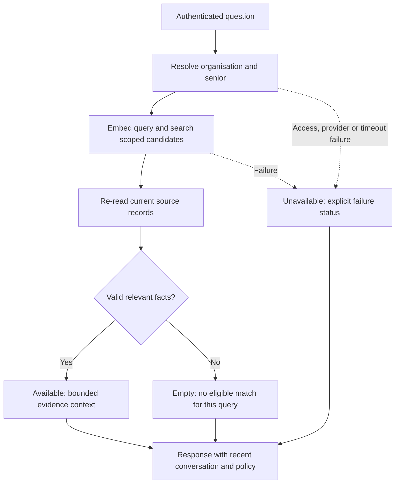
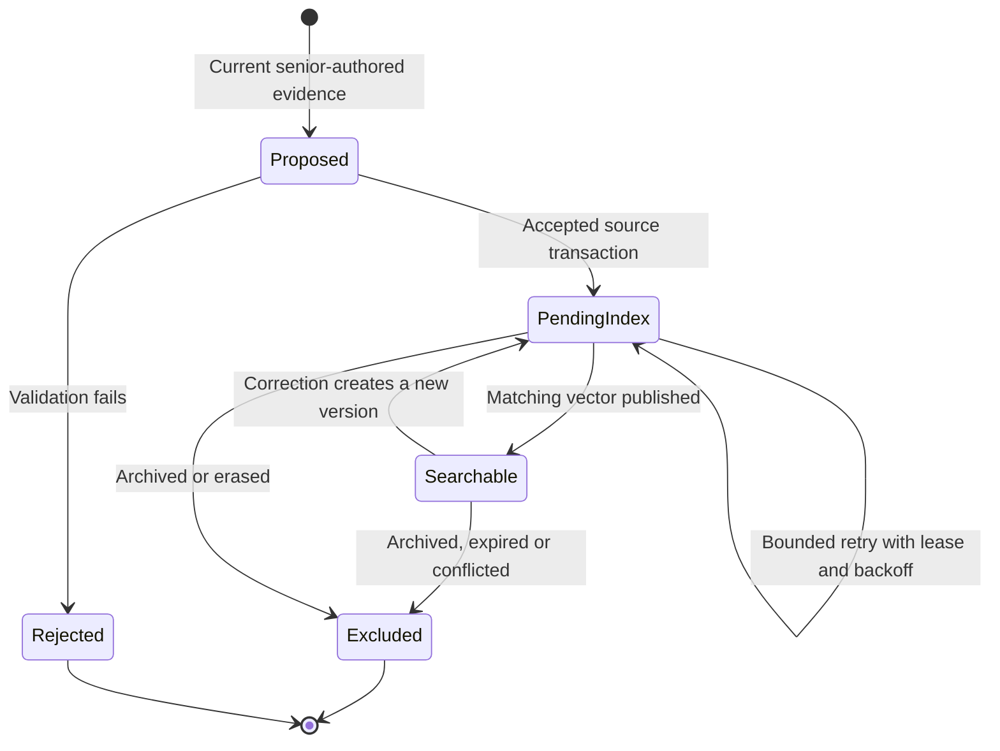

# Personal memory and retrieval-augmented generation

Technical overview · 17 October 2026

[Documentation](README.md) · [System architecture](ARCHITECTURE_GUIDE.md) · [Database operations](NEON_MEMORY_SETUP.md)

TrustKaki personalises conversations with selected, evidence-backed facts about the senior. Its retrieval-augmented generation (RAG) pipeline supplies relevant context while preserving source attribution, correction history and access boundaries. Recent conversation is supplied separately from durable personal memory.

[See RAG in the live workspace](PRODUCT_TOUR.md#4-rag-personalisation): the captured reply uses two retrieved preferences, with source and confirmation date visible beside it.

## Storage architecture

**Neon replaces Supabase as the application's personal-memory store. RAG is the
retrieval-and-generation method that uses that store.** RAG itself is not a database.

Supabase retains authentication, organisation/senior access, conversation messages,
cases, schedules, essential care/accessibility context and verified family contact
routing. Neon stores personal preferences and context, evidence references,
corrections, revisions, expiry, command receipts and vectors in one Postgres database.

The Pinecone vector index was a historical pilot. The current Neon path does not
write or query it. Pinecone's inference API still supplies embeddings; this is a
separate service from Pinecone vector storage.

## Tools and responsibilities

| Tool | Job |
| --- | --- |
| Supabase Auth and Postgres | Verify identity/access; retain messages and operational care data. |
| Neon Postgres | Canonical personal facts, lifecycle, revisions and retry receipts. |
| pgvector in Neon | Compare vectors to find semantically relevant facts within a senior's scope. |
| Pinecone inference, `llama-text-embed-v2` | Convert fact text and questions into 1,024-dimensional vectors. |
| Existing OpenAI-compatible chat adapter | Compose responses; configured deployment uses `gpt-4o-mini`. |
| `pg` and `@vercel/functions` | Restricted pooled database connections and Vercel pool lifecycle. |
| Zod | Validate requests, evidence, vectors, source records and agent outputs. |
| Vitest and PGlite with pgvector | Application tests and real local Postgres lifecycle/RLS tests. |
| Neon/Vercel CLIs and Neon agent skills | Development setup, deployment and verification. MCP is tooling, not a runtime dependency. |

Retrieval is implemented in server code behind typed repository interfaces. It does not require a separate conversational agent or an orchestration framework. Development tools and MCP connections are not runtime dependencies.

## How a memory is saved

1. A verified senior message reaches the existing extraction agent. It proposes a
   durable fact with an exact excerpt from that current senior-authored message.
2. Server code resolves organisation and senior from trusted identity/access data,
   validates evidence, purpose, confidence and expiry, and chooses the correct store.
   Essential routing/care context remains operational; personal facts go to Neon.
3. A scoped Neon transaction saves the canonical fact, source attribution, version,
   revision and command receipt. SQL row-level security isolates organisation and
   senior. Caller-supplied organisation IDs cannot grant access.
4. A bounded indexing attempt sends approved fact text to the embedding provider and
   stores its vector in Neon. Source version and embedding model must still match
   when the vector is published. Failed indexing leaves the source saved and pending.
5. Pending indexing retries through shared Neon claims on later writes/retrieval
   and a protected daily Vercel worker. The worker handles at most ten facts per run;
   leases and increasing delays prevent concurrent/immediate repeated charges.
   Five attempts per version require review if exhausted; corrections reset the cap.
   Daily scheduling does not guarantee immediate recovery.

## How a reply uses memory

1. Authenticate the caregiver or verify the channel identity, then resolve the senior.
2. Embed the current question. Search only that senior's authorised Neon scope using
   cosine similarity and a threshold calibrated for the configured embedding model.
3. Re-read current sources and exclude superseded, deleted, expired, conflicting,
   missing-evidence or stale-version facts. Vectors are search aids; current source
   records determine which facts may be used.
4. Return at most six facts, each content/excerpt at most 280 Unicode code points,
   within a 4,000-character JSON budget. Retrieval has a two-second deadline and
   explicit `available`, `empty` or `unavailable` status.
5. Give selected facts, provenance and timestamps to the agents as **untrusted
   evidence**, together with operational care context and dated conversation.
   Incoming statements and historical messages are labelled separately. A current
   explicit senior preference takes priority; otherwise newer confirmed facts
   supersede contradictory older conversation. Evidence cannot issue instructions.
6. Agents produce validated outputs. Deterministic policy remains the authority for
   operational risk and escalation. Personal memory does not diagnose or override
   verified contact routing or essential care/accessibility context.

There is no automatic fallback to Supabase personal memory in Neon mode. Database
failure does not silently restore an older fact. Runtime functions are placed in
Singapore beside Neon; the build machine may still run elsewhere.

## Correction example

A senior previously said they preferred porridge. A caregiver later confirms toast.
The correction increases the canonical version, preserves the old revision, and
invalidates its vector in the same transaction. Only the current version can be
indexed or retrieved. The agent should answer with toast when asked the remembered
preference. If the senior now explicitly asks for noodles, that current choice wins.

Exact command retries return the original receipt. Stale edits conflict rather than
overwrite newer changes. Archive excludes the fact from retrieval; replaying an old
extraction cannot resurrect it. Administrative edits require verified senior-admin
access and the expected update timestamp.

## Benefits and trade-offs

- **Relevant context:** semantic retrieval can find an older gardening preference
  when the senior asks about growing plants, despite different wording.
- **Bounded prompts:** only selected relevant facts reach the model, rather than
  the entire memory history. This can reduce prompt cost; savings are not yet measured.
- **Correctable memory:** source records, revisions and receipts support review,
  correction and lifecycle changes independently of a model conversation.
- **Reduced coupling:** chat-model choice is separate from storage and embeddings.
  Changing embedding model usually requires re-embedding and recalibration.
- **Simpler memory storage:** canonical facts and vectors share one database, avoiding
  synchronisation between a separate source database and vector index.

RAG does **not** automatically shrink storage. Embeddings add data. Retention,
consolidation, deduplication, pagination and archival still control growth. Exact
cosine search currently grows with each senior's corpus; ANN indexing and production
load measurements are future work.

## Migration and verification

Personal-memory records were migrated from Supabase to Neon with source/version reconciliation. Operational routing context remained in Supabase. Legacy personal-memory rows were frozen at cutover and subsequently removed through a reviewed, scoped migration. New personal-memory reads and writes use Neon without silently falling back to the old store.

Some migrated fictional facts initially lacked usable source provenance and were excluded from retrieval until confirmed through the caregiver correction flow. Migration does not manufacture evidence or turn demo facts into verified information about real seniors.

Bounded multilingual retrieval runs used 30 frozen questions across English, Mandarin and Singlish. Separate warm p95 measurements were 501 ms and 460 ms; neither run measured production scale or general conversation quality. [Results and limitations](VALIDATION.md).

Correction, archive, source-version and isolation checks are covered by the maintained tests. Independent-backup and post-restore erasure checks remain prerequisites for real-user deployment. [Recovery and retention](operations/PERSONAL_MEMORY_RECOVERY_RETENTION.md).

## Retrieval outcomes

An empty match is not a claim that the database contains no personal facts. An unavailable result is not permission to invent remembered details. Neither outcome silently restores obsolete Supabase personal-memory rows.

| Bound | Value |
| --- | --- |
| Search candidates | At most 20 |
| Selected facts | At most six |
| Fact content / evidence excerpt | At most 280 Unicode code points each |
| Context envelope | At most 4,000 Unicode code points |
| Retrieval deadline | Two seconds |
| Embedding compatibility | Matching model and source/index versions required |

## Memory lifecycle

The state view summarises retrieval eligibility rather than literal database status names. Corrections invalidate old vectors transactionally. Expiry and unresolved conflicts can exclude a record even if a vector still exists. Erasure follows the scoped retention procedure; an archived fact and a physically erased fact have different lifecycle semantics.

## Operating references

- [Active roadmap](TrustKaki_BUILD_ROADMAP.md)
- [Neon setup and safe commands](NEON_MEMORY_SETUP.md)
- [System architecture](ARCHITECTURE_GUIDE.md)
- [Retrieval](../src/lib/memory/retrieval.ts)
- [Authenticated integration](../src/lib/memory/applicationRepository.ts)
- [Transactions and RLS scope](../src/lib/memory/neonDatabase.ts)
- [Prompts](../src/lib/agents/prompts.ts)

## Deployment limitations

Independent-backup and post-restore erasure checks, retention review, production load measurement, broader reply-faithfulness evaluation and operational pilot requirements remain prerequisites for real senior use. Community-event availability requires a separate current source; a remembered interest does not establish that a suitable event exists.
