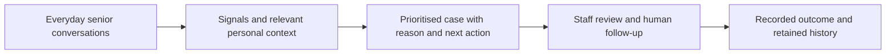

# Product: preserving human care capacity

[Overview](../../README.md) · [Demo guide](DEMO_GUIDE.md) · [Architecture](ARCHITECTURE.md) · [Validation](VALIDATION.md)

## Context

Singapore's ageing population creates a growing coordination challenge for community care. In 2026, 21.4% of citizens were aged 65 or above. One-person households among people aged 65 and above more than doubled between 2014 and 2024, from 42,100 to 87,200. Living alone does not itself establish frailty or a need for intervention. [NPTD population trends](https://www.population.gov.sg/our-population/population-trends/longevity/), [MOH living-alone data](https://www.moh.gov.sg/newsroom/addressing-loneliness-and-psychological-distress-among-seniors-living-alone/).

MOH projects the healthcare workforce to grow by about 20% between 2024 and 2030, and describes current staffing as broadly adequate. The business opportunity is to help community-care teams use staff time and shared information effectively as demand grows. These healthcare workforce figures provide broad context; they do not directly measure AAC staffing. [MOH workforce outlook](https://www.moh.gov.sg/newsroom/current-healthcare-workforce-strength-compared-against-projected-service-demand/).

## Users and workflow

- **Primary operator:** AAC staff reviewing multiple seniors and coordinating human follow-up.
- **Potential adopting organisation:** an AAC operator or community-care organisation. No paying customer or institutional deployment is claimed.
- **Beneficiaries:** seniors whose everyday context can be considered more consistently, plus caregivers who need clear handovers.

The operational pain includes repeated manual check-ins and fragmented context: reading many messages, recognising changes relative to routine, deciding which concern needs review, and knowing whether another staff member acted. TrustKaki connects these steps in a shared care workspace. Messaging adapters support conversational updates, the Telegram check-in workflow supports scheduled outreach when dispatched, and Pattern Watch combines observations across days before presenting evidence for staff review. [Implementation and activation boundaries](ARCHITECTURE.md#4-messaging-check-ins-and-multi-day-patterns).

## Why AI is useful

Senior messages can be indirect, multilingual and conversational. A change may also emerge over several check-ins rather than in one alarming message. Models interpret meaning and select relevant specialist reviews; semantic retrieval supplies bounded personal context. Deterministic code controls data access, validates evidence, enforces policy and records outcomes.

A practical example is a senior mentioning that they have stopped going downstairs and have missed meals. TrustKaki can surface those concerns together with relevant known preferences. It supports a staff decision about a check-in; it cannot establish the senior's actual condition from messages alone or guarantee the correct urgency.

## Implemented scope

| Area | Capability | Boundary |
| --- | --- | --- |
| Staff workflow | Prioritised senior case, reason, recommended human action, recorded outcomes and retained history | Human staff remain accountable for care decisions |
| Personal memory | Neon canonical facts, evidence, versions, corrections, archive and pgvector retrieval | Selective memory; no promise of perfect recall or bounded total storage |
| AI orchestration | Triage, active Jev specialist routing, conditional specialists and typed results | Deterministic policy retains final authority |
| Contextual tools | Government weather and regional air-quality data for relevant outdoor plans | Geographic, freshness and timing limits apply |
| Public access | No-login fictional walkthrough | No live model calls or care-record writes |
| Judge access | Authenticated live chat and recorded decision trail | Shared fictional demo state; credentials supplied privately |
| Channel conversations | Telegram/WhatsApp inbound handling, automatic replies and persistence | Current channel delivery requires configured providers; final WhatsApp delivery depends on business verification |
| Proactive check-ins | Telegram initial message, one reminder, response tracking and non-response case | Requires an authorised recurring caller; current repository cron schedules memory indexing only |
| Multi-day patterns | Saved-signal Pattern Watch and consolidated evidence-backed follow-up cases | Defined deterministic combinations; not clinical prediction |

**Out of scope:** autonomous clinical decisions, guaranteed diagnosis or scam detection, event booking and unrestricted outreach. This is a working fictional-data prototype, not an institutional deployment.

## Value hypotheses and pilot measures

| Hypothesis | Measure | Safeguard against misleading conclusions |
| --- | --- | --- |
| Staff can find important cases faster | Review time and time to first human response | Compare equivalent workloads; report missed concerns and false positives |
| Shared context improves handovers | Staff-rated usefulness and source-checked factual accuracy | Record incorrect or stale recalled facts, not just successful recalls |
| Follow-up becomes easier to account for | Unresolved cases, action completion and handover gaps | A closed case is not proof that the underlying care risk resolved |
| Personalisation is acceptable to seniors | Consent, preference correction and qualitative feedback | Respect refusals; avoid treating all conversations as permanent memory |

Time savings, cost savings, health outcomes and real-AAC adoption are not yet measured. A small earlier general-user demo check did not constitute AAC or clinical validation; the evidence summary states its limits.

## Real-care adoption prerequisites

Real-care deployment requires an authorised pilot, staff training, consent and retention arrangements, independently tested recovery/erasure, broader conversational evaluation, operational incident ownership and appropriate service monitoring. TrustKaki is currently a hackathon prototype with fictional demo records.

## Next-stage work

1. Validate staff workflow usefulness with AAC users and establish a meaningful comparison workload.
2. Measure multi-turn conversational faithfulness, missed concerns and false-positive follow-ups across broader language coverage.
3. Complete independent backup, post-restore erasure and retention requirements.
4. Measure memory-query performance on realistic per-senior corpora and assess approximate indexing when justified.
5. Introduce distributed rate limits and operational monitoring for multi-instance use.
6. Verify event sources and permissions before claiming current event availability or any automated outreach.

Feature work before submission is limited to defects that block the demonstrated workflow. Evidence and real-world outcomes are kept separate in [Validation](VALIDATION.md).
