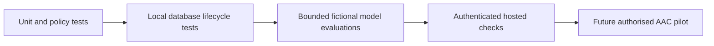

# Validation and known limits

[Documentation](README.md) · [Architecture](ARCHITECTURE_GUIDE.md) · [Business case](BUSINESS_CASE.md)

TrustKaki combines automated regression checks with bounded fictional live experiments. These cover different questions: structural correctness, retrieval eligibility, model behaviour, persistence and staff usability. None alone establishes clinical safety or real-world effectiveness.

## Verification layers



The sequence describes increasing integration and external validity, not a claim that the final pilot has happened. Live evaluations are separate from default offline tests and require scoped spending/data permissions.

## Selected recorded results

| Experiment | Observed result | Interpretation and limits |
| --- | --- | --- |
| Neon semantic retrieval, 15 October 2026 | 30/30 frozen questions: ten each English, Mandarin and Singlish; no forbidden facts; 1,007 fictional sources; warm p95 501 ms | Tests retrieval, not generated replies or production load. Query embedding, search and source validation included; ingestion/cold start excluded. [Report](evidence/2026-10-15-neon-semantic-retrieval.json) |
| Cutover retrieval check, 15 October 2026 | Same bounded corpus/questions; 30/30; no forbidden facts; warm p95 460 ms; isolation and fixture cleanup verified | A separate small run, not a speed comparison or multilingual conversation-quality claim. [Report](evidence/2026-10-15-neon-cutover-retrieval.json) |
| Jev routing screen, 16 October 2026 | 36 paired messages; all-six-label match 24/36 Jev versus 21/36 Triage adapter; nine false-positive flags each; successful-call p95 859 ms versus 3,494 ms; 74 attempts for 72 successful observations | Twelve semantic families translated three ways; developer labels, no clinician annotation. Adapter contracts and work differ, so this is not a fair general-intelligence ranking or an end-to-end chat-speed comparison. Latency summarises successful observations only. Failed attempts remain counted. [Report](evidence/2026-10-16-jev-routing-results.json) |
| Jev shadow full-chat review, 16 October 2026 | 12 flows completed; two unavailable-memory checks failed; manual review also found an unsupported physical-help offer | The flow completed but did not pass response-quality acceptance. Corrections followed; these results must not be relabelled as passes. Supplied fictional RAG context, not live Neon retrieval. [Report](evidence/2026-10-16-jev-whole-flow-results.json) |
| Earlier active-routing attempt, 16 October 2026 | Stopped after three saved flows on Jev schema failure | Partial evidence only. Retained reservations are not measured provider billing. [Report](evidence/2026-10-16-jev-active-partial-results.json) |
| Later active-routing coverage, 16 October 2026 | Twenty flows reviewed; automated checks flagged two active replies; manual review identified an additional recipe acknowledgement defect | Corrections narrowed routing and preserved conversational replies. The earlier run is not proof that those corrections pass a fresh paid evaluation. Source/harness stage `1e68ad7`. [Dated coverage record](https://github.com/minxie-ng/TrustKaki/blob/5ee6e254ff130da9acf2ce36714a18217493a4aa/trustkaki-web/docs/evidence/2026-10-16-jev-final-coverage.md). |
| Hosted integration, 17 October 2026 | Fictional Jev/refusal and accepted personal-preference checks were recorded as passing on a later candidate; scoped cleanup completed | Earlier attempts failed on duration persistence and memory evidence handling. Targeted fixes followed. Hosted samples do not establish broad conversation quality or erase earlier failures. [Dated hosted record](https://github.com/minxie-ng/TrustKaki/blob/5ee6e254ff130da9acf2ce36714a18217493a4aa/trustkaki-web/docs/operations/2026-10-17-final-memory-confirmation.md). |
| Earlier public-demo usability check, July 2026 | Three general users; one completed all tasks without coaching; all completed response/resolution/history task | Convenience sample; no AAC role established. Not AAC validation, clinical validation or evidence for the redesigned October UI. [Dated usability record](https://github.com/minxie-ng/TrustKaki/blob/5ee6e254ff130da9acf2ce36714a18217493a4aa/trustkaki-web/docs/evidence/2026-07-30-target-user-validation.md). |

These records concern their dated code and protocol. The current code has evolved since them. Current regression/build results can establish compatibility with a cleanup, but cannot retroactively extend a model benchmark's scope.

## Reproduce offline checks

```bash
cd trustkaki-web
npm ci
npm run validate
npm run benchmark:memory
```

Default checks cover typed contracts, policy, routing guards, memory scope/version/lifecycle behaviour, UI view models and local database fixtures. Live Supabase suites remain skipped unless explicitly enabled. Test count changes when obsolete pilot tests are retired; fewer tests do not imply that a remaining safety regression passed or failed.

## What remains unverified

- Clinical outcomes, reduced harm, prevented emergencies or prevented scams.
- AAC staff productivity, cost savings, real customer adoption and senior acceptability.
- Robust conversation quality across long dialogues, paraphrases, languages and unseen adversarial inputs.
- Million-user capacity, realistic concurrent loads and distributed rate limiting.
- Independent-backup recovery and post-restore erasure completeness.
- Guaranteed channel delivery or current third-party event availability.

Models can misinterpret a message even with valid JSON. Retrieval can be empty or unavailable, and remembered facts can be incorrect despite provenance. Human review, correction controls and scoped evaluation remain necessary.
